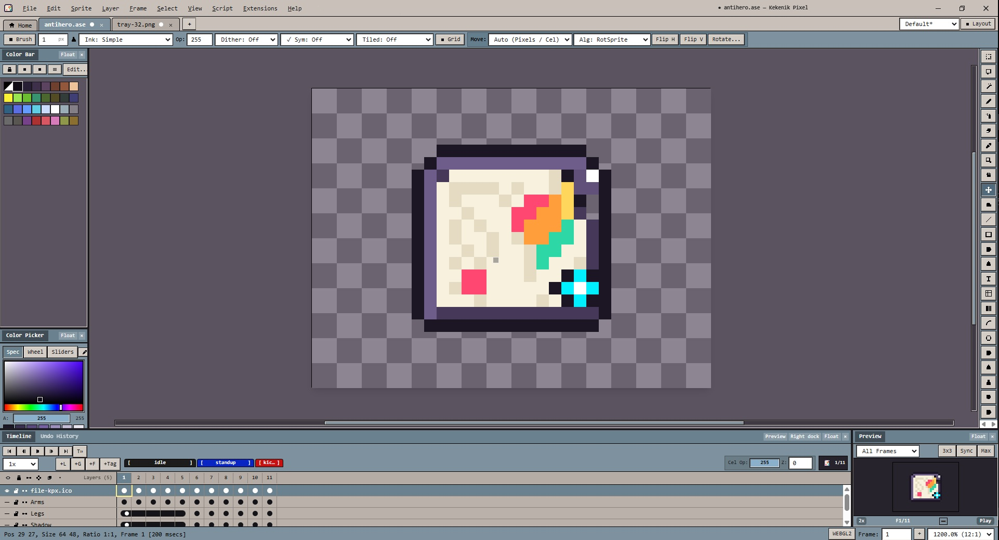

<div align="center" dir="rtl">

# Kekenik Pixel

### ویرایشگر حرفه‌ای پیکسل‌آرت و انیمیشن اسپرایت برای ویندوز، مک، لینوکس و مرورگر



<sub dir="ltr">[English](README.md) · فارسی</sub>

</div>

---

**Kekenik Pixel** یک استودیوی کامل پیکسل‌آرت است: موتور رسم پیکسل‌پرفکت، ماتریس کامل لایه/فریم/تایم‌لاین،
تاریخچه‌ی Undo غیرخطی، تایل‌مپ، انیون‌اسکین، خروجی اسپرایت‌شیت و سیستم افزونه و اسکریپت‌نویسی —
با یک رابط کاربری پیکسلی که کاملاً اختصاصی طراحی شده است. برنامه به‌صورت بومی روی ویندوز، مک و لینوکس
(با Electron) و همچنین داخل مرورگر اجرا می‌شود.

## دانلود

آخرین نسخه را از صفحه‌ی **[Releases](https://github.com/adam1442/Kekenik-Pixel/releases)** دریافت کنید.

| سیستم‌عامل | فایل | توضیح |
|---|---|---|
| **ویندوز ۱۰/۱۱ (x64)** | `KekenikPixel-<version>-win-x64-setup.exe` | نصب‌کننده (بدون نیاز به دسترسی ادمین) + ثبت پسوند `.kpx` |
| **ویندوز ۱۰/۱۱ (x64)** | `KekenikPixel-<version>-win-x64-portable.exe` | نسخه‌ی پرتابل؛ اطلاعات کنار خود فایل ذخیره می‌شود |
| **مک (Apple Silicon)** | `KekenikPixel-<version>-mac-arm64.dmg` | بدون امضای دیجیتال — بار اول راست‌کلیک → Open |
| **مک (Intel)** | `KekenikPixel-<version>-mac-x64.dmg` | بدون امضای دیجیتال — بار اول راست‌کلیک → Open |
| **لینوکس (x64)** | `KekenikPixel-<version>-linux-x64.AppImage` | `chmod +x` و اجرا |
| **لینوکس (x64)** | `...-linux-x64.deb` · `...-linux-x64.tar.gz` | پکیج دبیان/اوبونتو یا نسخه‌ی پرتابل |
| **مرورگر** | `KekenikPixel-<version>-web-bundle.html` | یک فایل HTML مستقل و آفلاین |

**بررسی سلامت فایل دانلودشده** با فایل `SHA256SUMS.txt` هر نسخه:

```bash
sha256sum -c SHA256SUMS.txt        # لینوکس
shasum -a 256 -c SHA256SUMS.txt    # مک
Get-FileHash -Algorithm SHA256 .\KekenikPixel-*.exe    # ویندوز (PowerShell)
```

> **نکته‌ی مک:** نسخه‌های فعلی امضا و notarize نشده‌اند. بار اول روی برنامه راست‌کلیک کرده و
> **Open** را بزنید، یا با دستور
> `xattr -dr com.apple.quarantine "/Applications/Kekenik Pixel.app"` محدودیت را بردارید.

## اجرا و توسعه

```bash
git clone https://github.com/adam1442/Kekenik-Pixel.git
cd kekenik-pixel
npm ci
npm run dev            # اجرا در مرورگر → http://localhost:5173
npm run dev:desktop    # اجرای نسخه‌ی دسکتاپ (Electron) با ری‌لود سریع
```

## ساخت نسخه‌های نصبی

```bash
npm run dist:win            # ویندوز: نصب‌کننده NSIS + نسخه‌ی پرتابل
npm run dist:win:portable   # ویندوز: فقط نسخه‌ی پرتابل
npm run dist:mac            # مک: DMG و ZIP برای x64 و arm64
npm run dist:linux          # لینوکس: AppImage + deb + tar.gz
npm run dist:dir            # نسخه‌ی باز‌شده (تست سریع بسته‌بندی)
```

خروجی‌ها در مسیر `release/<version>/` همراه با فایل‌های `.sha256` و `SHA256SUMS.txt` ساخته می‌شوند.

هر دستور بیلد، ابتدا کل زنجیره‌ی کنترل کیفیت را اجرا می‌کند:
تولید آیکون‌ها → typecheck → تست‌ها → بیلد وب → تأیید باندل → باندل‌های Electron → بسته‌بندی.
برای رد کردن مرحله‌ی تست از `-- --skip-tests` استفاده کنید.

> **قانون ساخت بین‌سیستمی:** بیلد ویندوز را روی ویندوز، بیلد مک را روی مک و بیلد لینوکس را روی لینوکس
> بگیرید. ساخت بیلد ویندوز روی لینوکس به نصب `wine` نیاز دارد و ساخت مک روی غیر مک ممکن نیست.
> ساده‌ترین راه، استفاده از همان GitHub Actions است: کافی است یک تگ مثل `v1.0.0` را push کنید.

## مستندات

| فایل | محتوا |
|---|---|
| [`docs/BUILD.md`](docs/BUILD.md) | پیش‌نیازها، بیلد هر پلتفرم، عیب‌یابی |
| [`docs/RELEASING.md`](docs/RELEASING.md) | فرآیند انتشار با تگ، امضای دیجیتال، فهرست خروجی‌ها |
| [`docs/FEATURES.md`](docs/FEATURES.md) | فهرست کامل امکانات و وضعیت تست |
| [`docs/THIRD_PARTY.md`](docs/THIRD_PARTY.md) | کتابخانه‌های ثالث و لایسنس‌ها |
| [`CHANGELOG.md`](CHANGELOG.md) | تاریخچه‌ی تغییرات |

## مشارکت و لایسنس

از گزارش باگ، پیشنهاد و Pull Request استقبال می‌شود — لطفاً ابتدا [`CONTRIBUTING.md`](CONTRIBUTING.md)
را بخوانید و پیش از ارسال، `npm run typecheck && npm test` را اجرا کنید.

شرایط استفاده در [`LICENSE.txt`](LICENSE.txt) آمده است. کتابخانه‌های متن‌باز ثالث تابع لایسنس خودشان هستند
(فهرست کامل در [`docs/THIRD_PARTY.md`](docs/THIRD_PARTY.md)).
