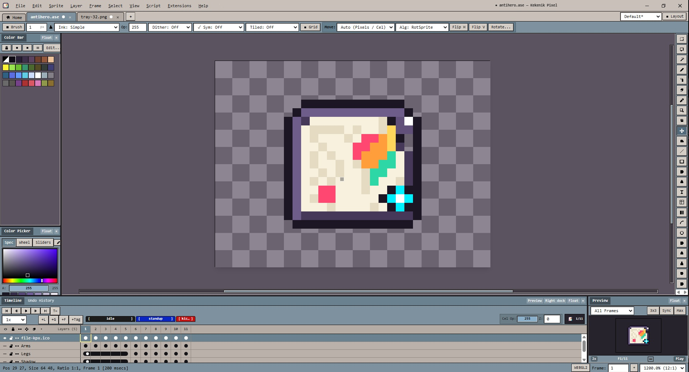

<div align="center">

# Kekenik Pixel

### A commercial-grade pixel-art & sprite-animation editor for Windows, macOS, Linux — and the browser.

[](https://github.com/adam1442/Kekenik-Pixel/releases)
[](https://github.com/adam1442/Kekenik-Pixel/actions/workflows/ci.yml)
[](#download)
[](#tech-stack)
[](LICENSE.txt)



**[Download](#download)** · **[Features](#features)** · **[Build from source](#build-from-source)** · **[Documentation](#documentation)** · **[Contributing](#contributing)**

<sub>English · <a href="README.fa.md">فارسی</a></sub>

</div>

---

Kekenik Pixel is a desktop-class pixel-art studio: a pixel-perfect drawing engine, a full
layer/frame/timeline matrix, non-linear undo, tilemaps, onion skinning, sprite-sheet export and
a scriptable extension system — wrapped in a hand-built pixel-art UI that runs natively on
Windows, macOS and Linux through Electron, or entirely in a browser tab.

* **100 % original code and artwork** — every icon, skin and font metric was drawn for this
  project. No imported sprites, no third-party UI kits. See [`docs/THIRD_PARTY.md`](docs/THIRD_PARTY.md).
* **Native where it matters** — real OS file dialogs, `.kpx` / `.aseprite` file associations,
  portable mode, window-state persistence, single-instance file hand-off.
* **Same code on every platform** — one TypeScript core shared by the desktop app and the
  single-file web build.

---

## Download

Grab the latest build from the **[Releases page](https://github.com/adam1442/Kekenik-Pixel/releases)**.

| Platform | File | Notes |
|---|---|---|
| **Windows 10/11 (x64)** | `KekenikPixel-<version>-win-x64-setup.exe` | Installer (per-user, no admin required), registers `.kpx` files |
| **Windows 10/11 (x64)** | `KekenikPixel-<version>-win-x64-portable.exe` | Single executable, stores data next to itself |
| **macOS — Apple Silicon** | `KekenikPixel-<version>-mac-arm64.dmg` | Unsigned; see the note below |
| **macOS — Intel** | `KekenikPixel-<version>-mac-x64.dmg` | Unsigned; see the note below |
| **Linux (x64)** | `KekenikPixel-<version>-linux-x64.AppImage` | `chmod +x` and run |
| **Linux (x64)** | `...-linux-x64.deb` · `...-linux-x64.tar.gz` | Debian/Ubuntu package, or a portable tarball |
| **Any browser** | `KekenikPixel-<version>-web-bundle.html` | Single self-contained HTML file — open it offline |

**Verify your download** — every release ships a `SHA256SUMS.txt`:

```bash
sha256sum -c SHA256SUMS.txt          # Linux
shasum -a 256 -c SHA256SUMS.txt      # macOS
Get-FileHash -Algorithm SHA256 .\KekenikPixel-*.exe   # Windows PowerShell
```

> **macOS note** — builds are not code-signed or notarized yet. On first launch, right-click the
> app → **Open**, or clear the quarantine flag:
> `xattr -dr com.apple.quarantine "/Applications/Kekenik Pixel.app"`.

---

## Features

**Drawing engine**
- Pixel-perfect pencil with stabilizer, Bresenham line/curve tools, rectangle, ellipse, polygon, contour, gradient, paint bucket, spray, blur, jumble and bitmap text
- 20+ ink modes (simple, alpha compositing, copy-alpha, lock-alpha, shading) and a full procedural + custom-bitmap brush engine with pressure/velocity dynamics, dithering (Bayer 2×2/4×4/8×8) and brush library slots
- WebGL2 tile renderer with a Canvas2D dirty-rect fallback, adaptive pixel grid, tile grid, symmetry guides and tiled (wrap-around) drawing

**Layers, frames & animation**
- Layer trees with groups, linked cels, reference layers, per-cel opacity, 18+ blend modes, merge/flatten
- Timeline matrix with cel range selection, drag-and-drop, tags with loop modes, subtag playback, frame-rate multipliers
- Onion skinning (before/after, red/blue tint, loop-through-tag), live animation preview, slices with pivots and 9-patch data
- Tilemap layers with tilesets, flip/rotate flags, auto/manual tile modes

**Editing & UI shell**
- Non-linear, branching undo history with region-patch storage and a memory budget
- Dockable + floating panels, four workspace presets, three themes, 100/200/300 % UI scale
- Full menu bar, keyboard-shortcut editor with conflict detection, command palette, log viewer and a self-testing Feature Center (`F1`)
- English + Persian (فارسی, RTL) localization

**Files & extensibility**
- Native `.kpx` project format with crash-recovery snapshots; **`.aseprite` / `.ase` read + write**
- Export to PNG, APNG, GIF, WebP, JPEG, BMP, ICO, TGA, QOI, PCX, FLI/FLC, SVG and CSS `box-shadow`
- Sprite-sheet export with layout modes, trimming, extrusion and JSON metadata
- Sandboxed scripting runtime + extension packages (themes, palettes, keymaps, language packs) — see [`samples/extensions`](samples/extensions)

> The complete, machine-checked catalogue of every feature and its test status lives in
> [`docs/FEATURES.md`](docs/FEATURES.md) and inside the app under **Help → Feature Center**.

---

## Tech stack

| Layer | Technology |
|---|---|
| Language | TypeScript 5 (strict) |
| UI | React 19, Zustand, Tailwind CSS 4, custom pixel skins (no component library) |
| Rendering | WebGL2 + Canvas2D fallback, `Uint8Array` RGBA/grayscale/indexed pixel buffers |
| Shell | Vite 7 (single-file web bundle) · Electron 45 + electron-builder 26 |
| Tests | Vitest (215 tests across core, formats, scripting, layout, UI shell and build wiring) |

---

## Quick start (development)

```bash
git clone https://github.com/adam1442/Kekenik-Pixel.git
cd kekenik-pixel
npm ci            # requires Node.js 22.12+ (or run: npm install)
npm run dev       # browser dev server  → http://localhost:5173
```

Desktop development (bundles the Electron main/preload processes, starts Vite, launches Electron):

```bash
npm run dev:desktop
```

Useful scripts:

| Command | What it does |
|---|---|
| `npm run dev` / `npm run dev:web` | Vite dev server (browser build) |
| `npm run dev:desktop` | Electron app with hot-reloading renderer |
| `npm run typecheck` | `tsc --noEmit` for the workspace **and** the Electron sources |
| `npm test` | Full Vitest suite |
| `npm run build:web` | Single-file web bundle + release-bundle verification |
| `npm run build:desktop` | Electron `main.mjs`, `preload.cjs` and `desktop.html` bundles |
| `npm run generate:icons` | Regenerate every icon/installer bitmap from code |

---

## Build from source

Full details, prerequisites and troubleshooting: **[`docs/BUILD.md`](docs/BUILD.md)**.

```bash
npm run dist:win            # Windows: NSIS installer + portable EXE
npm run dist:win:portable   # Windows: portable EXE only
npm run dist:mac            # macOS: DMG + ZIP for x64 and arm64
npm run dist:linux          # Linux: AppImage + deb + tar.gz
npm run dist:dir            # Unpacked app (fast packaging smoke test)
npm run dist:web            # Web bundle only
```

Output lands in `release/<version>/` together with `.sha256` sidecars and a `SHA256SUMS.txt`.

**Cross-compilation rules of thumb**

| Host | Can build |
|---|---|
| Windows | Windows natively · Linux via Docker (`npm run dist:linux:docker`) |
| macOS | macOS + Windows (best effort) + Linux natively |
| Linux | Linux natively · Windows **only with wine** installed |

Every packaging command first runs the full gate — icon generation, typecheck, tests, web
bundle, release verification, Electron bundles — so an installer can never be produced from a
broken tree. Use `-- --skip-tests` to skip the test step once you have run it separately.

### Releases & CI

* `.github/workflows/ci.yml` — typecheck, tests and web bundle on every push/PR, plus real
  Windows/Linux packaging smoke tests on `main`.
* `.github/workflows/release.yml` — push a tag and it builds **Windows, macOS (x64 + arm64) and
  Linux**, computes `SHA256SUMS.txt` and publishes everything to a GitHub Release:

  ```bash
  npm version patch          # or minor / major
  git push --follow-tags     # → triggers the release workflow
  ```

* macOS/Windows code signing can be enabled later purely through repository secrets
  (`CSC_LINK`, `CSC_KEY_PASSWORD`, …) — no code changes required. See
  [`docs/RELEASING.md`](docs/RELEASING.md).

---

## Project structure

```
kekenik-pixel/
├── packages/
│   ├── core/        Pure TypeScript: document model, non-linear history, 8 registries,
│   │                rendering, drawing tools, brushes, layers/frames/animation, selection,
│   │                filters, palettes, file formats, scripting, i18n — no DOM, no React
│   └── ui/          React + Zustand UI: menu bar, docking, panels, dialogs, timeline,
│                    workspaces, themes, Feature Center
├── apps/desktop/    Electron main process, preload bridge, Electron platform adapter
├── src/             Browser entry point (Vite)
├── desktop.html     Electron renderer entry point
├── scripts/         Build orchestration, icon generation, release verification
├── build/           NSIS installer script + branding bitmaps
├── assets/icon/     Generated icon masters (.ico/.icns/.png, tray, `.kpx` file icons)
└── docs/            Build guide, feature catalogue, decisions, third-party notices
```

---

## Dependency health

* `npm audit` → **0 critical, 0 high** (the remaining moderate findings are inside
  electron-builder's packaging toolchain and never reach the shipped application).
* The app itself ships **no `node_modules`**: the renderer is a single bundled HTML file, the main
  process and preload are bundled to one file each, so the packaged `app.asar` is ~5 MB.
* A handful of `npm warn deprecated` lines still come from electron-builder's own tree
  (`glob@7`, `rimraf@2`, `boolean@3`, …); they are build-time only and documented in
  [`docs/BUILD.md`](docs/BUILD.md#remaining-npm-warn-deprecated--lines-during-install).

---

## Documentation

| Document | Contents |
|---|---|
| [`docs/BUILD.md`](docs/BUILD.md) | Prerequisites, per-platform packaging, troubleshooting |
| [`docs/RELEASING.md`](docs/RELEASING.md) | Tag-based release flow, signing, artifact matrix |
| [`docs/FEATURES.md`](docs/FEATURES.md) | Full feature catalogue with test status |
| [`docs/THIRD_PARTY.md`](docs/THIRD_PARTY.md) | Third-party components and licenses |
| [`docs/DECISIONS.md`](docs/DECISIONS.md) | Architecture decision record |
| [`docs/KNOWN_ISSUES.md`](docs/KNOWN_ISSUES.md) | Known limitations |
| [`CHANGELOG.md`](CHANGELOG.md) | Release history |

---

## Contributing

Bug reports, feature requests and pull requests are very welcome — please read
[`CONTRIBUTING.md`](CONTRIBUTING.md) first, and run `npm run typecheck && npm test` before
opening a PR.

* 🐞 **Found a bug?** [Open an issue](https://github.com/adam1442/Kekenik-Pixel/issues/new/choose)
* 💡 **Have an idea?** Start a [discussion](https://github.com/adam1442/Kekenik-Pixel/discussions)
* 🔐 **Security issue?** Please follow [`SECURITY.md`](SECURITY.md) instead of a public issue

---

## License

Kekenik Pixel is distributed under the terms in [`LICENSE.txt`](LICENSE.txt). Third-party
open-source components remain under their own licenses — see [`docs/THIRD_PARTY.md`](docs/THIRD_PARTY.md).

<div align="center">

**Made with care, one pixel at a time.**

</div>
